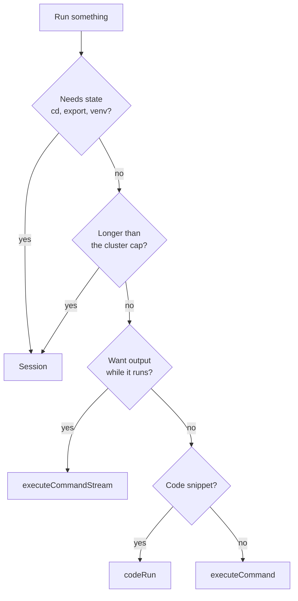

# Commands and code

`sandbox.process` (TS) / `sandbox.Process` (Go) runs things inside the sandbox. Three ways:

| Call                     | Returns                          | Use for                                         |
| ------------------------ | -------------------------------- | ----------------------------------------------- |
| `executeCommand`         | exit code + output, at the end   | short shell commands                            |
| `codeRun`                | exit code + output + charts      | a snippet of Python, TypeScript or JavaScript   |
| `executeCommandStream`   | output **while** it runs         | builds, tests, anything long or chatty          |

> [!IMPORTANT]
> All three are **stateless**: `cd` and `export` do not carry over to the next call. For a shell that keeps its
> state, use a [session](sessions.md).

A non-zero exit code is a result, not an error.

## executeCommand

<details open>
<summary><b>TypeScript</b></summary>

```ts
// executeCommand(command, cwd?, env?, timeout = 10, container?)
const result = await sandbox.process.executeCommand('ls -la');
console.log(result.exitCode); // 0
console.log(result.result); // stdout followed by stderr
console.log(result.artifacts?.stdout, result.artifacts?.stderr); // apart

// working directory, env and a longer timeout (seconds)
const test = await sandbox.process.executeCommand('pytest -q', '/home/coder/project', { CI: '1' }, 120);
if (test.exitCode !== 0) {
  console.error(test.artifacts?.stderr);
}

// in another container of the pod (a sidecar)
await sandbox.process.executeCommand('redis-cli ping', undefined, undefined, 10, 'redis');
```

</details>

<details>
<summary><b>Go</b></summary>

```go
result, err := sandbox.Process.ExecuteCommand(ctx, "ls -la")
fmt.Println(result.ExitCode, result.Result)

test, err := sandbox.Process.ExecuteCommand(ctx, "pytest -q",
	options.WithCwd("/home/coder/project"),
	options.WithCommandEnv(map[string]string{"CI": "1"}),
	options.WithExecuteTimeout(2*time.Minute),
)
if err == nil && test.ExitCode != 0 {
	fmt.Println(test.Artifacts.Stderr)
}

_, err = sandbox.Process.ExecuteCommand(ctx, "redis-cli ping", options.WithContainer("redis"))
```

</details>

### Timeouts

> [!WARNING]
> The default timeout is **10 seconds**. The cluster caps the maximum (300 seconds by default). A command that
> runs past its timeout is stopped and the call throws `MogeniusProcessExecutionTimeoutError`.

For anything that runs longer, use `executeCommandStream` with a larger timeout or a background
[session command](sessions.md), which has no time limit.

<details open>
<summary><b>TypeScript</b></summary>

```ts
import { MogeniusProcessExecutionTimeoutError } from '@mogenius/sandbox';

try {
  await sandbox.process.executeCommand('sleep 30', undefined, undefined, 2);
} catch (err) {
  if (err instanceof MogeniusProcessExecutionTimeoutError) console.log('took too long');
}
```

</details>

## codeRun

Runs a snippet with the sandbox's default language (`python` unless set at create) or the one you pass:
Python through `python3`, TypeScript through `tsx`, JavaScript through `node`. The code travels base64-encoded —
quotes and newlines need no escaping.

<details open>
<summary><b>TypeScript</b></summary>

```ts
// codeRun(code, params?, timeout = 10)
const py = await sandbox.process.codeRun(`
import json, sys
print(json.dumps({"python": sys.version.split()[0]}))
`);
console.log(py.result);

const ts = await sandbox.process.codeRun('const x: number = 42; console.log(x)', { language: 'typescript' });
const js = await sandbox.process.codeRun('console.log(process.argv.slice(2))', {
  language: 'javascript',
  argv: ['a', 'b'],
  env: { DEBUG: '1' },
});

// longer runs: third argument, seconds
await sandbox.process.codeRun(longScript, undefined, 120);
```

</details>

| Param       | Meaning                                                          |
| ----------- | ---------------------------------------------------------------- |
| `language`  | `python`, `typescript` or `javascript`; overrides the default    |
| `argv`      | Script arguments (`sys.argv[1:]`, `process.argv.slice(2)`)       |
| `env`       | Environment for this run                                         |
| `container` | Container to run in; the sandbox's own when absent               |

<details>
<summary><b>Go</b></summary>

```go
py, err := sandbox.Process.CodeRun(ctx, `print("hello")`)

ts, err := sandbox.Process.CodeRun(ctx, `console.log(42)`,
	options.WithCodeRunLanguage(types.CodeLanguageTypeScript))

js, err := sandbox.Process.CodeRun(ctx, `console.log(process.argv.slice(2))`,
	options.WithCodeRunLanguage(types.CodeLanguageJavaScript),
	options.WithCodeRunParams(types.CodeRunParams{Argv: []string{"a", "b"}, Env: map[string]string{"DEBUG": "1"}}),
	options.WithCodeRunTimeout(2*time.Minute),
	options.WithCodeRunContainer("worker"),
)
```

</details>

### Charts from matplotlib

Figures a Python run draws with matplotlib come back as PNG charts in `artifacts.charts` — on `plt.show()` and
for every figure still open at the end. The image only needs matplotlib.

Each chart has `type` (`line`, `bar`, `scatter`, `pie`, `composite` for several axes, or `unknown`), `title`
(the figure's or axis' title) and `png` (base64).

<details open>
<summary><b>TypeScript</b></summary>

```ts
import { writeFileSync } from 'node:fs';

const run = await sandbox.process.codeRun(`
import matplotlib.pyplot as plt
plt.plot([1, 2, 3, 4], [1, 4, 9, 16])
plt.title("squares")
plt.show()
`);

for (const [i, chart] of (run.artifacts?.charts ?? []).entries()) {
  console.log(chart.type, chart.title); // e.g. "line" "squares"
  if (chart.png) writeFileSync(`chart-${i}.png`, Buffer.from(chart.png, 'base64'));
}
```

</details>

<details>
<summary><b>Go</b></summary>

```go
for i, chart := range run.Artifacts.Charts {
	if chart.Png != nil {
		png, _ := base64.StdEncoding.DecodeString(*chart.Png)
		os.WriteFile(fmt.Sprintf("chart-%d.png", i), png, 0o644)
	}
}
```

</details>

## executeCommandStream

*mogenius addition.* Same parameters as `executeCommand`, but output arrives while the command runs. Events are
`stdout` / `stderr` with bytes, and finally one `exit` event.

> [!TIP]
> **Leaving the loop early stops the command** in the container — `break` as soon as you have what you need.

> [!NOTE]
> Needs `organizationId` and `clusterId` in the config (see [Getting started](getting-started.md#configure)).

<details open>
<summary><b>TypeScript</b></summary>

```ts
const decoder = new TextDecoder();

for await (const event of sandbox.process.executeCommandStream('npm test', '/home/coder/project', {}, 300)) {
  switch (event.type) {
    case 'stdout':
    case 'stderr':
      process.stdout.write(`${event.type}: ${decoder.decode(event.data)}`);
      break;
    case 'exit':
      console.log('exit', event.exitCode);
      if (event.timedOut) console.log('stopped at the timeout'); // exit code 137
      if (event.truncated) console.log('output exceeded the cluster cap; the rest was dropped');
  }
}

// stop as soon as the server says it is ready
for await (const event of sandbox.process.executeCommandStream('npm run build -- --watch', undefined, undefined, 300)) {
  if (event.type === 'stdout' && decoder.decode(event.data).includes('built in')) break; // stops the command
}
```

</details>

<details>
<summary><b>Go</b></summary>

```go
for event, err := range sandbox.Process.ExecuteCommandStream(ctx, "npm test",
	options.WithCwd("/home/coder/project"),
	options.WithExecuteTimeout(5*time.Minute),
) {
	if err != nil {
		return err
	}
	switch event.Type {
	case types.ExecEventStdout, types.ExecEventStderr:
		os.Stdout.Write(event.Data)
	case types.ExecEventExit:
		fmt.Println("exit", event.ExitCode, "timed out:", event.TimedOut, "truncated:", event.Truncated)
	}
}
```

</details>

## Which one?



---

<p align="center"><a href="sandboxes.md">← Sandboxes</a> &nbsp;·&nbsp; <a href="README.md">Overview</a> &nbsp;·&nbsp; <a href="sessions.md">Sessions →</a></p>
