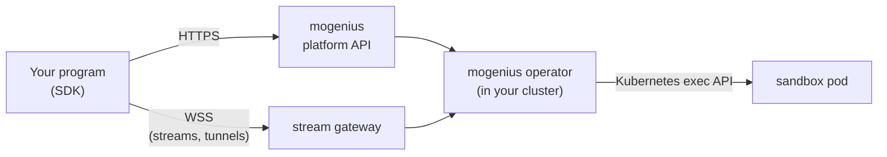
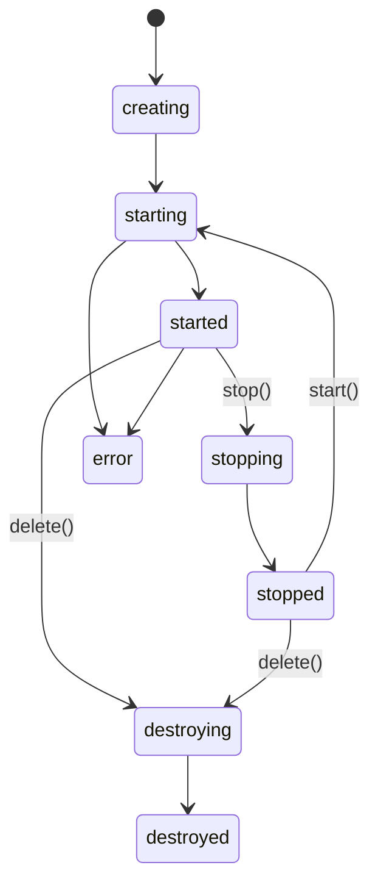

# Concepts

## How a call reaches the sandbox



- **No agent in the image, no open port on the pod.** The operator runs commands and file operations through
  the Kubernetes exec API. Any image works.
- **Your cluster, your rules.** Sandboxes run as pods in your own cluster; RBAC applies and every action is
  audited under the identity of the API key.
- Plain calls (lifecycle, commands, files, sessions) go over HTTPS to the platform API. Live output and tunnels
  go over a WebSocket to the stream gateway.

## Sandboxes, profiles and warm pools

A sandbox is built on [kubernetes-sigs/agent-sandbox](https://github.com/kubernetes-sigs/agent-sandbox).

| Term           | Meaning                                                                                                  |
| -------------- | -------------------------------------------------------------------------------------------------------- |
| **Profile**    | A pod template (image, resources, env policy) plus a warm pool of that name. In the SDK it is `snapshot`. |
| **Warm pool**  | Pre-started pods of a profile. `create()` without an image claims one — ready in seconds.               |
| **Own image**  | `create({ image })` stamps a new pod from the profile's template with your image — a normal pod start.  |
| **Namespace**  | Where the sandbox chart puts sandboxes; `agent-sandbox` by default. In the SDK also `target`.          |

Profiles are configured on the cluster's **Sandboxes** page in the mogenius platform. The SDK picks the profile
in this order: `snapshot` in the create params → the configured `profile` (`MOGENIUS_SANDBOX_PROFILE`) →
`default`. To see which warm pools a cluster has, in which namespace and how many of their sandboxes are ready,
use [`warmPools()`](sandboxes.md#warm-pools).

<details open>
<summary><b>TypeScript</b></summary>

```ts
await mogenius.create(); // warm pool of the configured profile
await mogenius.create({ snapshot: 'python-data' }); // warm pool of "python-data"
await mogenius.create({ image: 'node:22', snapshot: 'python-data' }); // own image in that profile's template
```

</details>

## The sandbox id

`sandbox.id` is the name of the `SandboxClaim` (warm pool) or the `Sandbox` object (own image) — `sandbox.data.kind`
(TS) or `sandbox.Kind` (Go) says which. Every SDK call takes this id; `get(id)` gives you a handle back later, from
another process too.

## States



| State        | Meaning                                                          |
| ------------ | ---------------------------------------------------------------- |
| `creating`   | The claim or sandbox object exists, no pod yet                   |
| `starting`   | The pod is coming up; `errorReason` says what it is waiting for  |
| `started`    | Ready for commands, files, sessions and tunnels                  |
| `stopping`   | `stop()` was called, the pod is going                            |
| `stopped`    | No pod, the volume stays; `start()` brings it back               |
| `error`      | Something failed; `errorReason` says what                        |
| `destroying` / `destroyed` | `delete()` was called                              |

## Lifetime and storage

- `autoDeleteInterval` (minutes) sets a deadline; the sandbox is shut down then. `expiresAt` shows when.
  `setAutoDeleteInterval(0)` removes it.
- `ephemeral` (default `true`): pod **and** storage go when the sandbox is deleted or its lifetime ends.
- `stop()` keeps the volume; `start()` comes back with the same files.

> [!TIP]
> Give every sandbox an `autoDeleteInterval`. If your program crashes before it deletes the sandbox, the cluster
> cleans up on its own.

## Pods and containers

Commands, files and sessions address the sandbox's pod (`podName`) and, by default, its own container
(`containerName`). If the pod has sidecars, every call that runs something takes an optional `container`.

## What is not available

Sandboxes are Kubernetes pods, not micro-VMs. These calls exist for compatibility but throw
`MogeniusUnsupportedError` with the reason and the alternative:

| Call                                          | Instead                                                     |
| --------------------------------------------- | ----------------------------------------------------------- |
| `fork()` / `ExperimentalFork`                 | Create a new sandbox from the same profile                  |
| `archive()` / `Archive`, `Pause`              | `stop()` — the volume stays                                 |
| `setAutoArchiveInterval`                      | Delete the sandbox, or keep it stopped                      |
| `setAutostopInterval` (TS)                    | `setAutoDeleteInterval` for a fixed lifetime (idle stop is planned) |
| `mogenius.snapshot`, `ExperimentalCreateSnapshot` | Profiles are configured on the cluster's Sandboxes page |
| `mogenius.volume`                             | Each sandbox gets its own volume from the profile           |

`autoStopInterval` and `autoArchiveInterval` in the create params are accepted and ignored.

---

<p align="center"><a href="getting-started.md">← Getting started</a> &nbsp;·&nbsp; <a href="README.md">Overview</a> &nbsp;·&nbsp; <a href="sandboxes.md">Sandboxes →</a></p>
